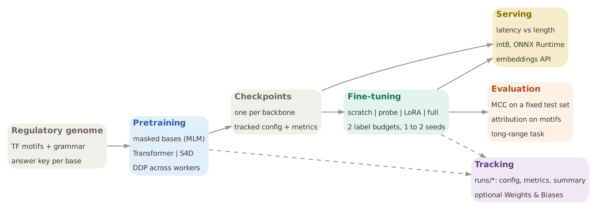
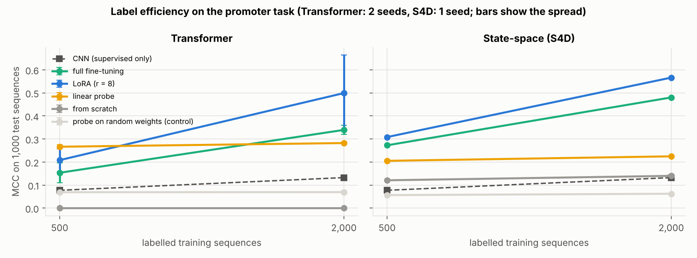
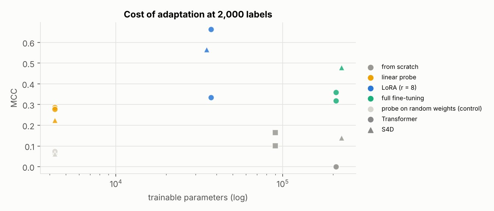
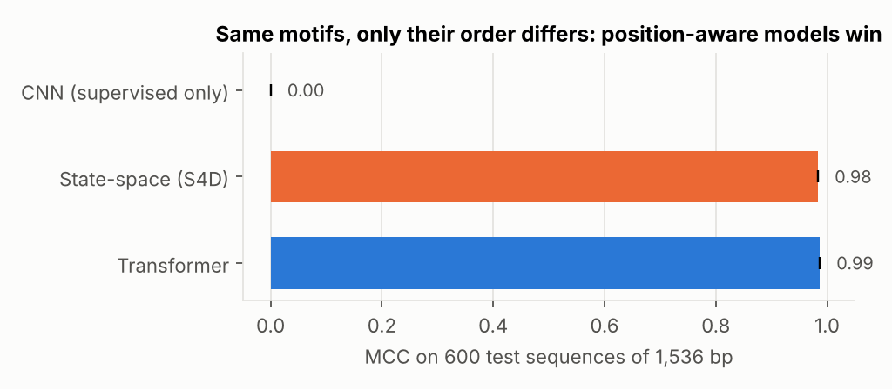
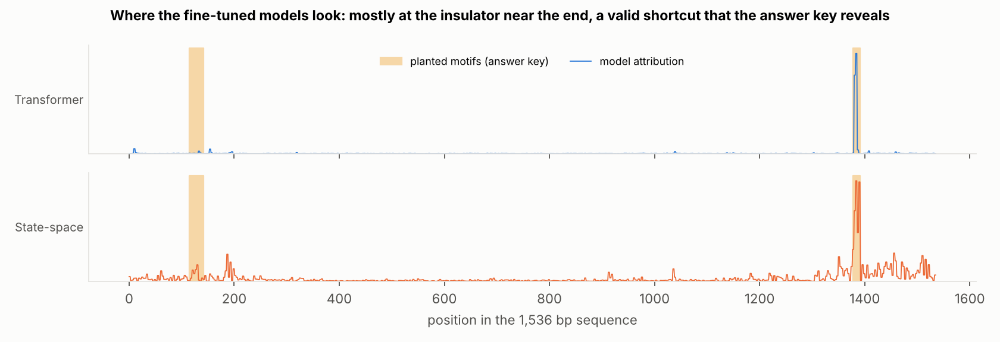
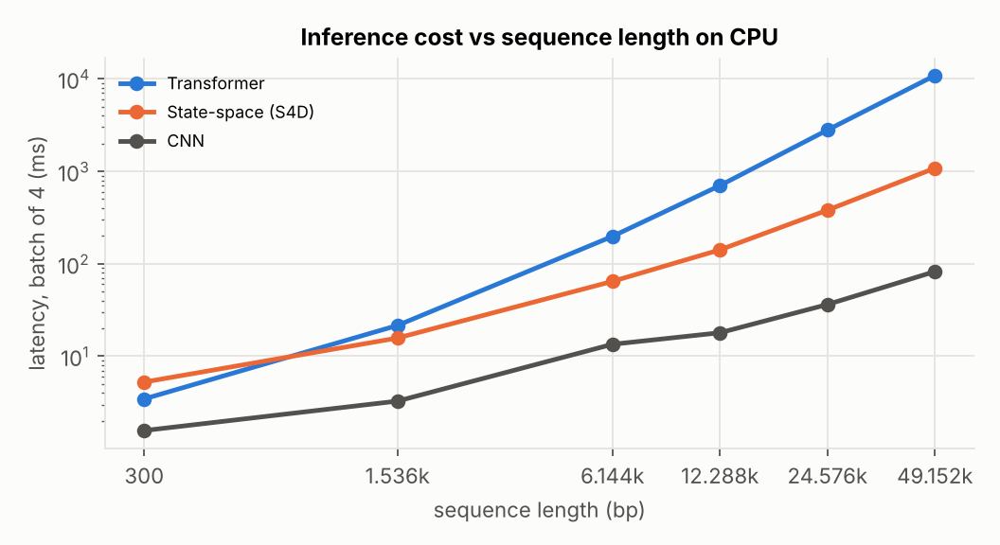
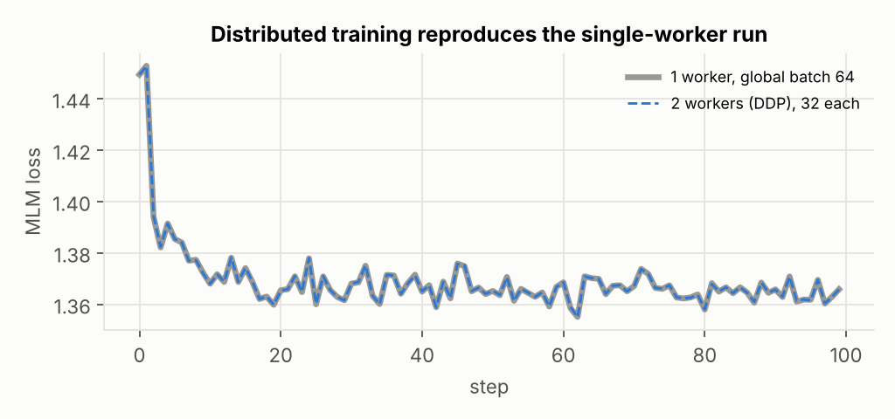

# genomic-fm-lab

**A small DNA foundation model, built and measured end to end: masked-language pretraining of a Transformer and a
state-space model (S4D), four ways to adapt it (from scratch, linear probe, LoRA, full fine-tuning), attribution
checked against an answer key, distributed training, inference benchmarks, experiment tracking, Docker and CI.**

   



## Why this project

Bio foundation models (DNA, RNA and single-cell models) are only useful once someone can adapt them to a new task
with few labels, serve them fast on long sequences, and prove what they learned. I wanted to work through that whole
loop myself, on a budget where every step can be rerun on a laptop:

| Question | Where it is answered |
|---|---|
| Does pretraining buy anything when labels are scarce, and is the gain real or an artefact? | label efficiency, with a random-weights control |
| How much of the model must be trained? Full fine-tuning, LoRA or a linear probe? | adaptation cost |
| Attention or state-space mixing for long DNA? | long-range task and inference scaling |
| Does the model look at the right bases? | attribution scored against the planted motifs |
| Is the distributed setup correct before it is used to go faster? | DDP equivalence check |
| What do int8 quantization and ONNX Runtime really give on CPU? | serving benchmarks, accuracy checked after each step |

## The data: a regulatory genome with an answer key

Real genomes do not say which bases matter, so this lab generates DNA with a human-like background (41 % GC, CpG
depleted) and plants textbook transcription-factor motifs (TATA box, GC box, CCAAT box, AP-1, CREB, CTCF, GATA,
E-box) following a regulatory grammar. Every planted base is recorded, which lets the benchmark score not only
accuracy but where the model looks.

* **Pretraining corpus**: 40,000 unlabelled 300 bp sequences, half promoter-like regions, half background with stray
  motifs in any order. No label is used.
* **Promoter task** (300 bp): positive when a GC or CCAAT box sits 30 to 110 bp upstream of a TATA box. Negatives
  carry only one of them, or both in the wrong order. A bag of k-mers reaches 70 % accuracy; a one-hot CNN needs about
  10,000 labels to pass 95 %, so the low-label regime is where pretraining has to prove itself.
* **Long-range task** (1,536 bp): the same enhancer and insulator motifs in every sequence, only their order over
  about 1,300 bp differs.

`gfm.data.load_real()` loads the human promoter benchmark of Genomic Benchmarks (Grešová et al., 2023) on a machine
with internet access; every number below comes from the synthetic tasks, run on 2 CPU cores.

## Models

| Component | Detail | Code |
|---|---|---|
| Stem | one-hot bases, strided convolution (9 bp window, stride 3): 300 bp become 100 tokens, motifs recognised in any frame | [`models.py`](gfm/models.py) |
| Transformer | 4 pre-norm blocks, 64 dimensions, 4 heads, sinusoidal positions, PyTorch scaled dot-product attention | `Backbone("transformer")` |
| State-space model | bidirectional diagonal SSM with S4D-Lin initialisation, applied as an FFT long convolution, gated; kernel cached at inference | `S4DMixer` |
| CNN baseline | dilated residual CNN, trained with labels only | `CNNBackbone` |
| LoRA | low-rank adapters (r = 8) on attention, projection and MLP layers, base weights frozen, starts as the identity | `LoRALinear`, `add_lora` |
| Pretraining | masked modelling of whole tokens (15 %, 80/10/10 rule), AdamW, cosine schedule, 4,000 steps | [`train.py`](gfm/train.py) |

## Results

### 1. Pretraining pays off when labels are scarce, and the control proves it



<!-- RESULTS:START -->
| Backbone | Adaptation | MCC, 500 labels | MCC, 2,000 labels | Trainable parameters | Attribution on motifs |
|---|---|---:|---:|---:|---:|
| Transformer | full fine-tuning | 0.15 ± 0.04 | 0.34 ± 0.02 | 207,874 | 44 % |
| Transformer | LoRA (r = 8) | 0.21 ± 0.05 | 0.50 ± 0.17 | 37,058 | 46 % |
| Transformer | linear probe | 0.27 ± 0.01 | 0.28 ± 0.00 | 4,290 | 49 % |
| Transformer | probe on random weights (control) | 0.07 ± 0.00 | 0.07 ± 0.01 | 4,290 | 8 % |
| Transformer | from scratch | 0.00 ± 0.00 | 0.00 ± 0.00 | 207,874 | 7 % |
| State-space (S4D) | full fine-tuning | 0.27 | 0.48 | 224,770 | 34 % |
| State-space (S4D) | LoRA (r = 8) | 0.31 | 0.57 | 35,010 | 40 % |
| State-space (S4D) | linear probe | 0.21 | 0.23 | 4,290 | 33 % |
| State-space (S4D) | probe on random weights (control) | 0.06 | 0.06 | 4,290 | 9 % |
| State-space (S4D) | from scratch | 0.12 | 0.14 | 224,770 | 8 % |
| CNN (supervised only) | from scratch | 0.08 ± 0.01 | 0.13 ± 0.03 | 90,114 | 40 % |

Matthews correlation on the same 1,000 test sequences; ± is the spread over 2 seeds (Transformer, CNN); S4D was run
with 1 seed. "Attribution on motifs" is the share of the 4 most attributed tokens that fall on a planted motif.
<!-- RESULTS:END -->

* **The same frozen backbone gives an MCC of 0.27 when pretrained and 0.07 with random weights**: the gain comes from
  what pretraining learned, not from the architecture. The pretrained probe also looks at the motifs (49 % of its top
  tokens) where the random one does not (8 %).
* **Without pretraining, the Transformer does not learn at all with 500 or 2,000 labels** (MCC 0.00); the CNN, built
  for this kind of data, reaches only 0.13 with 2,000 labels.
* **LoRA is the best trade-off**: with under 18 % of the parameters trained, it matches or beats full fine-tuning on both
  backbones (0.57 against 0.48 on S4D). It is also the least stable: 0.33 and 0.66 for two seeds of the Transformer,
  so a single run would have misled me.



### 2. Position-aware models solve the long-range task; a pooled CNN cannot



Pretrained Transformer 0.99 MCC, pretrained S4D 0.98, CNN 0.00 (it pools away position, and a bag of k-mers reaches
53 %). The answer key then shows **how** the models solved it:



Both models look mostly at the insulator near the end of the sequence and much less at the enhancer 1,300 bp
upstream. That is a valid shortcut (in this design the position of one motif is enough), and it would have stayed
invisible without base-level ground truth. A task that truly needs both ends, for example a variable distance between
them, is the next design step.

### 3. Serving: attention costs O(n²), the state-space model O(n log n)



| Sequence length | Transformer | S4D | CNN |
|---:|---:|---:|---:|
| 1,536 bp | 22 ms | 16 ms | 3 ms |
| 49,152 bp | 10.9 s | 1.1 s | 0.08 s |

Forward pass for a batch of 4 on 2 CPU cores. The SSM becomes cheaper than attention below 1,536 bp and is
**10 times faster at 49 kb**. Caching the SSM kernel at inference (it does not depend on the input) was the change
that made this possible: before it, the SSM was slower than attention at every length.

| Fine-tuned Transformer, 300 bp | Latency per sequence | Accuracy | Size |
|---|---:|---:|---:|
| PyTorch fp32 | 0.53 ms | 65.5 % | 0.83 MB |
| Dynamic int8 (Linear layers) | 0.49 ms | 65.2 % | |
| ONNX Runtime (CPU) | 2.25 ms | 65.5 % | 1.94 MB |

Measured, not assumed: int8 saves 8 % of latency for 0.3 point of accuracy, and ONNX Runtime was **4 times slower**
than PyTorch here, on a model this small. The S4D layer does not export to ONNX, because its FFT operator has no
ONNX opset 17 equivalent; serving it would need the convolution written without FFT, or TorchScript.

### 4. Distributed training is checked before it is trusted



`torchrun --nproc_per_node 2 -m gfm.ddp` (gloo backend on CPU, nccl on GPUs) splits a global batch of 64 across 2
workers and all-reduces the gradients. Same seed and same samples: the loss curves agree to 5 × 10⁻⁴ over 100 steps.
On 2 CPU cores the speed-up is only 3 % because a single process already uses both cores; the point here is
correctness, the same script scales on GPUs.

## Engineering

| What | How |
|---|---|
| Experiment tracking | every run writes `runs/<group>/<id>/` with its config, git commit, a JSONL metric stream and a summary; mirrored to Weights & Biases when `WANDB_API_KEY` is set ([`tracking.py`](gfm/tracking.py)) |
| Reproducibility | seeded data, models and sampling; resumable experiment grid; fixed test set for every run |
| Model API | `GenomicFM.from_pretrained(...)`, `get_embeddings`, `fine_tune(mode="lora")`, `predict` ([`api.py`](gfm/api.py)) |
| Packaging | `Dockerfile` (CPU PyTorch, tests run at build), `Makefile`, GitHub Actions CI |
| Tests | 8 tests: answer-key masks, masking, shared backbone interface, LoRA identity at start, SSM on 12 kb, a tiny end-to-end run |

## Run

```bash
pip install -r requirements.txt
pytest -q                          # 8 tests, a few seconds
python run.py                      # whole study, about 1.5 h on 2 CPU cores, resumable
python run.py --stage bench        # one stage: pretrain | grid | longrange | bench | ddp | report
make docker                        # build, test and run inside Docker
```

Pretrained checkpoints (Transformer and S4D, under 1 MB each) are in `checkpoints/`, so fine-tuning and the API work
without rerunning the pretraining.

```python
from gfm.api import GenomicFM
fm = GenomicFM.from_pretrained("s4d")
embeddings = fm.get_embeddings(sequences)          # (n, 64)
fm.fine_tune(train_sequences, train_labels, mode="lora")
probabilities = fm.predict(test_sequences)
```

## Limits

* Synthetic data and small models (about 200,000 parameters, 4,000 pretraining steps on CPU). The lab is built to
  measure methods with an answer key, not to compete with Nucleotide Transformer, HyenaDNA or Caduceus; the real
  Genomic Benchmarks loader is there for the next step.
* The masked-modelling loss ends close to the entropy of the background (1.33 to 1.35 against 1.37 nats): at this budget the
  model learns the motifs and their grammar, not the background, which is what the downstream tasks need.
* 1 seed for S4D and 2 for the Transformer: the LoRA spread shows why more seeds would be needed before any claim
  finer than the large gaps reported here.
* Ray, mixed precision and multi-GPU runs are not covered: the DDP script and the tracker are ready for them.

## License

MIT
